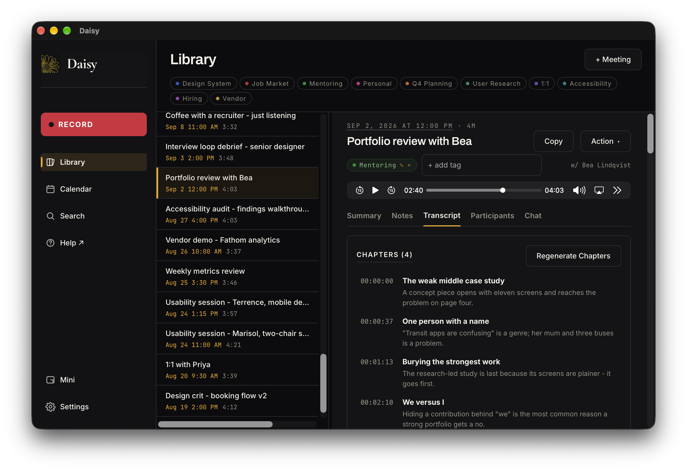
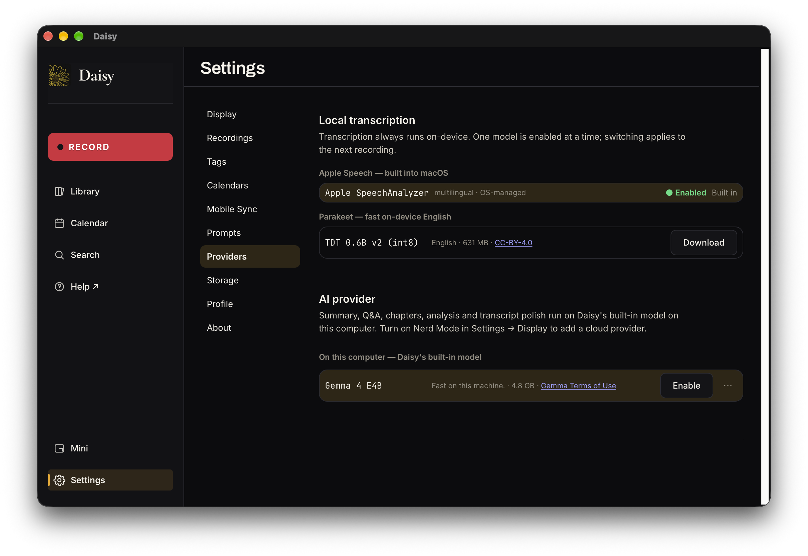
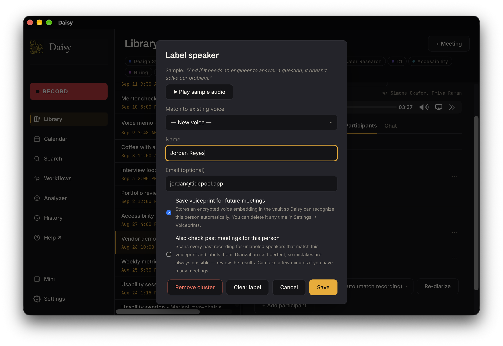
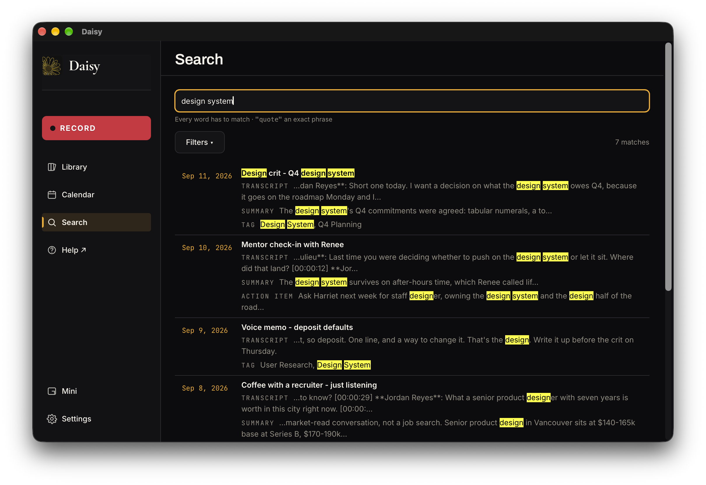
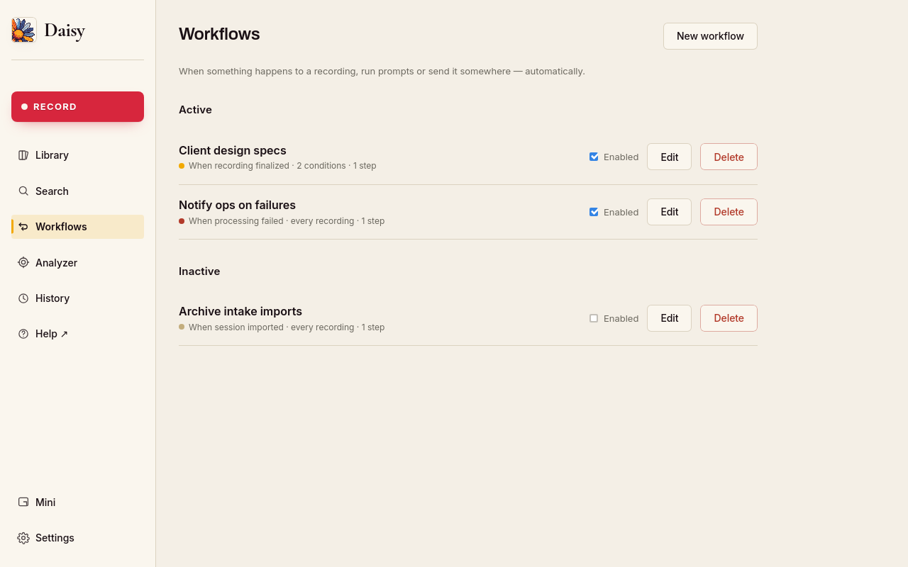
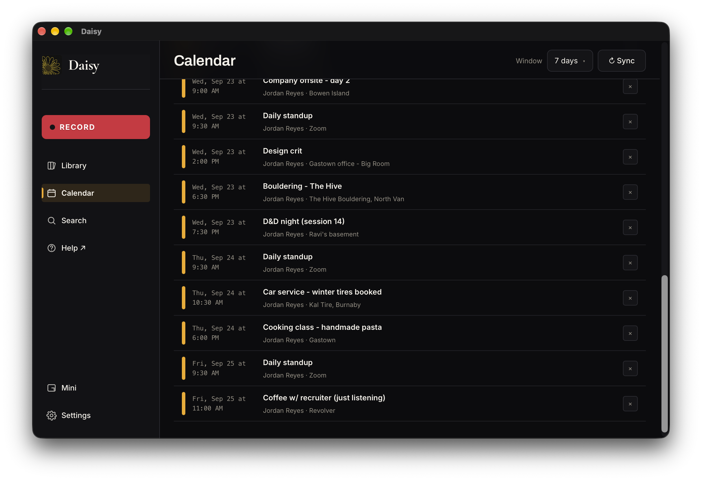

<div align="center">

<picture>
  <source media="(prefers-color-scheme: dark)" srcset="apps/frontend/public/daisy-logo-gold.png" />
  
</picture>

<picture>
  <source media="(prefers-color-scheme: dark)" srcset="docs/img/introducing-daisy-dark.svg" />
  
</picture>

**Private meeting notes AI, fully on-device.**

Daisy records, transcribes, and summarizes your meetings with AI that
runs on your own device. Your meetings never reach us. Your privacy,
your control.

[](https://www.daisylocal.app)
[](LICENSE)
[](#privacy-first)
[](https://www.daisylocal.app/#download)



</div>

---

## Privacy first

Recording, transcription, and speaker names all happen on your
computer.

- **Your audio never leaves.** Recordings and transcripts stay in a
  folder you choose.
- **Locked to you.** Keys and voice profiles are encrypted on your
  computer.
- **HIPAA and PHI ready.** Daisy can keep protected health information
  on your device. [HIPAA & PHI guide →](https://www.daisylocal.app/help/hipaa)
- **Your choice to share.** Transcript text goes out only if you pick a
  cloud AI or send it somewhere yourself.
- **Your phone, your computer.** Phone recordings travel only to your
  own computer, over your own network.

---

## Why Daisy

- **Private by design.** Your meetings stay on your computer. Nothing is
  sent to us, ever.
- **Private AI.** Transcripts, summaries, and answers are made on your
  own device. No key, no cloud.
- **No bot in your call.** Daisy records Zoom, Meet, Teams, or any call
  quietly from your computer. Nobody else listens in.
- **Private voice profiles.** Name a voice once and Daisy remembers it,
  encrypted and kept on your computer.
- **Private from phone to desk.** Meetings you record on iPhone or iPad
  travel only to your own computer.
- **You decide what's shared.** Keep everything on your device, or
  choose a cloud AI when you want one.

---

## What you get

 **Record any conversation.** Both sides of the call, clear and
separate.

 **Live captions.** Watch the words appear as people talk, then
tap any line to hear that moment again.

 **Built-in AI.** Daisy comes with its own AI and sets it up for
you. Summaries and answers never leave your computer.

<div align="center"></div>

 **Knows every voice.** Name someone once and Daisy recognizes
them in every meeting after.

<div align="center"></div>

 **Summaries written for you.** Decisions, action items, and next
steps, in your words: *"you committed to send the contract by Friday."*

 **Ask your meetings anything.** *"What did we decide about the
launch?"* Daisy answers and takes you to the moment it was said.

 **Find anything.** Search every meeting at once, in any language.

<div align="center"></div>

 **Your own prompts.** Ask Daisy to look at any meeting the way
you want.

 **Hands-free follow-up.** When a meeting ends, Daisy can send the
notes to Slack, Notion, or wherever your team works.

<div align="center"></div>

 **Your calendar, one click away.** Start recording any meeting
straight from your calendar.

<div align="center"></div>

 **Your phone and computer, together.** Record on the go with
Daisy for iPhone and iPad; the meeting arrives on your computer, ready
to review.

 **Bring in any recording.** Voice memos and audio files get the
same treatment.

 **Tags that work for you.** Daisy suggests tags for every meeting,
and each project gets its own summary style.

 **Locked to you.** Your keys and voice profiles are encrypted on
your computer.

 **A license you own.** Free for 30 days. One license,
3 devices.

---

## What you bring

| Feature | Daisy alone | + Daisy's built-in AI¹ | + your own AI | + cloud AI |
|---|:--:|:--:|:--:|:--:|
| **Complete Privacy** | ✅ | ✅ | ✅ | — |
| Recording, no bot | ✅ | ✅ | ✅ | ✅ |
| Transcripts and live captions | ✅ | ✅ | ✅ | ✅ |
| Speaker names | ✅ | ✅ | ✅ | ✅ |
| Search, calendar, tags | ✅ | ✅ | ✅ | ✅ |
| Phone sync and imports | ✅ | ✅ | ✅ | ✅ |
| Workflows | ✅ | ✅ | ✅ | ✅ |
| Summaries | — | ✅ | ✅ | ✅ |
| Ask your meetings | — | ✅ | ✅ | ✅ |
| Your own prompts | — | ✅ | ✅ | ✅ |

¹ On computers with a capable graphics card.

---

## Download

Free 30-day trial at **[daisylocal.app](https://www.daisylocal.app)**
for Mac (Apple Silicon), Windows, and Linux.

---

## How it's built

Everything runs on your machine; each claim maps to a crate you can read:

```
┌─ Your machine ──────────────────────────────────────────────────────────┐
│                                                                         │
│          ┌──────────────────────┐    ┌──────────────────────┐           │
│          │ Mic                  │    │ System audio         │           │
│          │ your voice           │    │ your speakers' output│           │
│          └──────────┬───────────┘    └──────────┬───────────┘           │
│                     └─────────────┬─────────────┘                       │
│                                   ▼                                     │
│          ┌──────────────────────────────────────────────────┐           │
│          │ Echo cancellation — WebRTC AEC3       crates/aec │           │
│          └────────────────────────┬─────────────────────────┘           │
│                                   ▼                                     │
│          ┌──────────────────────────────────────────────────┐           │
│          │ On-device transcription — live captions          │           │
│          │ Nemotron (Win/Linux) · SpeechAnalyzer (macOS)    │           │
│          │                           crates/providers-local │           │
│          └────────────────────────┬─────────────────────────┘           │
│                                   ▼                                     │
│          ┌──────────────────────────────────────────────────┐           │
│          │ Who said what — diarization   crates/voiceprints │           │
│          └────────────────────────┬─────────────────────────┘           │
│                                   ▼                                     │
│          ┌──────────────────────────────────────────────────┐           │
│          │ Transcript cleanup · dedup     crates/transcript │           │
│          └────────────────────────┬─────────────────────────┘           │
│                                   ▼                                     │
│          ┌──────────────────────────────────────────────────┐           │
│          │ Summary · Q&A · workflows       crates/summarize │           │
│          │ Built-in AI — Gemma 4 E4B on    crates/daisy-llm │           │
│          │ llama.cpp (Metal / Vulkan)                       │           │
│          └──────────────────────────────────────────────────┘           │
│                                                                         │
│          ┌─ On disk — your folder ──────────────────────────┐           │
│          │ audio · transcript · summary · notes · search    │           │
│          └──────────────────────────────────────────────────┘           │
│          ┌─ Encrypted vault — Argon2id + AES-256-GCM ───────┐           │
│          │ API keys · voiceprints              crates/vault │           │
│          └──────────────────────────────────────────────────┘           │
│          ┌─ Mobile Sync — your network only ────────────────┐           │
│          │ paired phone ──▶ this desktop, TLS + LAN / BLE   │           │
│          │ recordings in, pipeline here   crates/ble · sync │           │
│          └──────────────────────────────────────────────────┘           │
│                                                                         │
└───────────────────────────────────┬─────────────────────────────────────┘
                                    ┆  transcript text only — never audio
                                    ┆  optional · your key · off by default
                                    ▼
                ┌─ Your chosen LLM ────────────────────┐
                │ cloud with your key — or fully local │
                └──────────────────────────────────────┘
```


The only recording data that can leave your computer is transcript text, and only
if you pick a cloud AI. Audio never does. Read the
**[security & threat model](docs/SECURITY.md)** for the details.

## Read the source, pay for the build

This repository holds the **desktop app** (macOS, Windows, Linux) and
is **source-visible**, so you can verify that audio never leaves your
machine. Daisy for iPhone and iPad is closed source. Issues welcome;
pull requests are not accepted (see [CONTRIBUTING.md](CONTRIBUTING.md)).

Build it yourself ([`docs/BUILDING.md`](docs/BUILDING.md)):

```bash
bash scripts/setup-dev.sh                 # apt deps + rustup + node + pnpm
bash scripts/download-nemotron.sh         # bundled nemotron ASR model (win/linux)
bash scripts/download-nemotron3-diar.sh   # live speaker-name model
bash scripts/download-embeddings.sh       # Q&A embedding model
bash scripts/download-voiceprints.sh      # speaker-recognition models
bash scripts/stage-daisy-llm.sh           # built-in AI worker (sidecar)

pnpm --dir apps/frontend install --frozen-lockfile
pnpm --dir apps/frontend build
cargo build --release -p tauri-app --features custom-protocol
./target/release/daisy-app
```

The paid product is the signed, notarized, auto-updating build at
[daisylocal.app](https://www.daisylocal.app). Self-builds are free for
personal, non-commercial use.

---

## License

The desktop app is **source-visible under the
[Elastic License 2.0](LICENSE)** with an added permission: for
**personal, non-commercial use** you may build and run it without a
license, even with the license gate disabled. Commercial use requires a
[paid license](https://www.daisylocal.app). Offering Daisy as a product
or service, or distributing builds with the license gate removed, is
not permitted. The Daisy name and logo are trademarks
([TRADEMARK.md](TRADEMARK.md)). Bundled components keep their own
licenses, listed in the app under Settings → About → Open-source
licenses.

---

## Credits

- [Tauri](https://github.com/tauri-apps/tauri) — the application shell
- [whisper.cpp](https://github.com/ggerganov/whisper.cpp) via
  [whisper-rs](https://codeberg.org/tazz4843/whisper-rs) — on-device transcription
- [WebRTC audio processing](https://gitlab.freedesktop.org/pulseaudio/webrtc-audio-processing) (AEC3) via
  [webrtc-audio-processing-rs](https://github.com/tonarino/webrtc-audio-processing) — acoustic echo cancellation
- [Nemotron Speech Streaming 0.6B](https://huggingface.co/nvidia/nemotron-speech-streaming-en-0.6b) by
  NVIDIA (NVIDIA Open Model License), ONNX export adapted from
  [sherpa-onnx](https://github.com/k2-fsa/sherpa-onnx) (Apache-2.0), republished on
  [daisy-local](https://github.com/smallbricktory/daisy-local/releases/tag/asr-nemotron-streaming-en-0.6b-560ms-int8-1) —
  on-device transcription on Windows and Linux
- [NVIDIA Nemotron 3 Diarization](https://huggingface.co/nvidia/Nemotron-3-Diarization)
  by NVIDIA (OpenMDW-1.1), ONNX export republished on
  [daisy-local](https://github.com/smallbricktory/daisy-local/releases/tag/diarizer-nemotron3-ga-2026-09-23-1) —
  live speaker names
- [pyannote](https://github.com/pyannote/pyannote-audio) segmentation-3.0 (MIT),
  with its ONNX runner adapted from [speakrs](https://github.com/avencera/speakrs)
  (Apache-2.0), and [WeSpeaker](https://github.com/wenet-e2e/wespeaker) embeddings —
  speaker diarization
- [Granite Embedding 97M multilingual r2](https://huggingface.co/ibm-granite/granite-embedding-97m-multilingual-r2)
  by IBM (Apache-2.0) — search & Q&A embeddings
- [ONNX Runtime](https://github.com/microsoft/onnxruntime) via
  [ort](https://github.com/pykeio/ort) — model inference
- [llama.cpp](https://github.com/ggml-org/llama.cpp) via
  [llama-cpp-2](https://github.com/utilityai/llama-cpp-rs) — built-in AI inference
- [Gemma 4 E4B](https://huggingface.co/google/gemma-4-E4B-it) by Google
  ([Gemma Terms of Use](https://ai.google.dev/gemma/terms)), GGUF by
  [unsloth](https://huggingface.co/unsloth/gemma-4-E4B-it-GGUF) — built-in AI model
- [Opus](https://opus-codec.org/) — audio compression


---

## Why Daisy exists

Daisy was originally built to help our hard-of-hearing child take better
notes in first year — and it kind of took off from there. Something that
used to be genuinely hard suddenly became achievable, as with many
things AI. Privacy mattered as much as making it work well —
and the final transcripts are great. But mostly, Daisy is out here to
help people.

### About us

Small Bricktory is the culmination of a decades-long journey of
self-discovery in technology as a craft and a hobby. Technology is our
paintbrush, our clay — and in the final analysis, anything created must
be freely available for anyone to enjoy. That is why we exist.

---

<div align="center">
<sub>Local-first · macOS + Windows + Linux + iPhone + iPad · Built for people who want their meetings to stay theirs.</sub>
</div>
